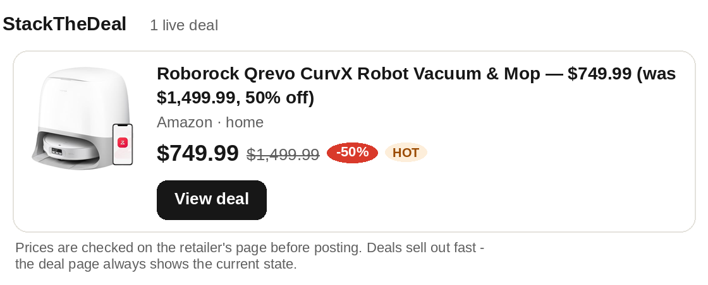
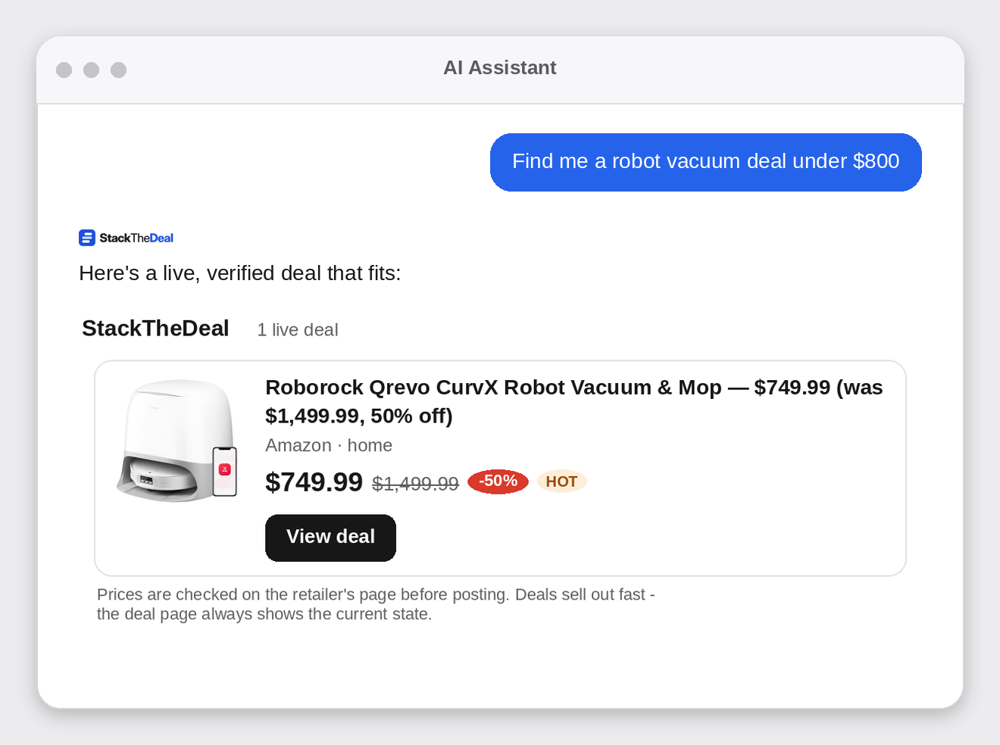

# StackTheDeal Deals — MCP Server


**Live, verified deals for your AI assistant.** StackTheDeal checks every
price on the retailer's own page before posting and keeps every deal
marked live or expired — this MCP server lets ChatGPT, Claude, and any
other MCP client search that live feed instead of guessing prices from
months-old training data.



## Connect

Server URL (remote, streamable HTTP, **no authentication**):

```
https://stackthedeal.com/mcp
```

- **ChatGPT** — Settings → Connectors → **New connector** → name
  `StackTheDeal Deals`, URL above, Authentication: **None**.
- **Claude** — Settings → Connectors → **Add custom connector** → name
  `StackTheDeal Deals`, URL above.
- **Any other MCP client** — add a remote/streamable-HTTP server with the
  URL above; no API key or sign-in needed.

Step-by-step instructions with screenshots-friendly detail:
**[stackthedeal.com/connect-ai](https://stackthedeal.com/connect-ai/)**
or [`docs/connect.md`](docs/connect.md) in this repo.

Then just ask: *"Find me a coffee maker under $50"*, *"What are today's
hottest Amazon deals?"*, *"Is this deal still live?"*

## Tools

All four tools are read-only — the server cannot buy anything, see your
data, or change anything.

| Tool | What it does |
|---|---|
| `list_deals` | Browse live deals; filter by category, store, minimum discount, or hot deals. |
| `search_deals` | Keyword search across all live deals (products, stores, travel). |
| `get_deal` | One deal by slug, with full details and current live/expired state. |
| `get_site_stats` | Coverage and freshness: how many live deals, which stores, last update. |

## Interactive deal cards

In clients that support MCP Apps (SEP-1865) — including Claude and
ChatGPT — deal results render as **visual cards**: product photo, price,
was-price, discount badge, and live/expired state, each with a button to
the deal's page. Clients without Apps support get the same deals as
structured text; nothing is lost either way.

## What it looks like



## How it works — the honest design

Results link to the deal's own page on **stackthedeal.com**, and that is
where any purchase happens. That design is deliberate: it's how we honor
each retail network's rules (Amazon Associates, for example, permits its
links on our own pages, not fed raw to AI systems without written
approval), it keeps one canonical place where the price is re-verified,
and it means a dead deal shows EXPIRED instead of sending you to a
sold-out page. Prices and availability change fast — the retailer's page
is always final. StackTheDeal may earn a commission from qualifying
purchases made through its links, at no cost to the shopper.

## Coverage

- **330 live deals** across **30 stores** (Amazon, Walmart, Best Buy,
  Home Depot, Costco, REI, and more), refreshed continuously and policed
  by a liveness patrol that retires dead deals within minutes.
- **Travel** — flights and hotels via Travelpayouts (Aviasales,
  Hotellook, Booking.com partners), with tracked booking links.
- More catalogs (CJ and others) are being wired into the same feed.

## Links

- Website — https://stackthedeal.com
- Connect page — https://stackthedeal.com/connect-ai/
- MCP server — https://stackthedeal.com/mcp
- Official MCP Registry listing — https://registry.modelcontextprotocol.io/v0/servers?search=stackthedeal (`com.stackthedeal/deals`)
- Privacy policy — https://stackthedeal.com/privacy-policy/
- Disclosure — https://stackthedeal.com/disclosure/
- Support — https://stackthedeal.com/contact/

## Terms of use of the data

Deal data may be shown with attribution to StackTheDeal and a link to
the deal's page on stackthedeal.com. No scraping or bulk redistribution
of the full deal feed without written permission.

## License

The contents of this repository (documentation and server descriptor)
are released under the [MIT License](LICENSE). The MCP server itself is
a hosted service; connecting to it is free.
